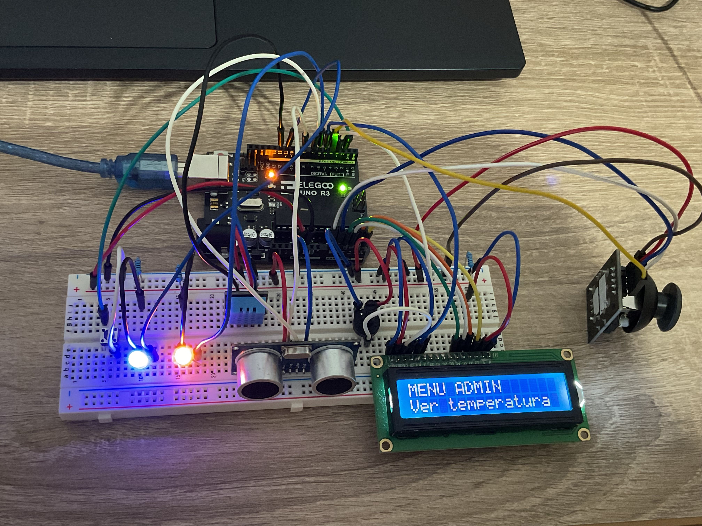
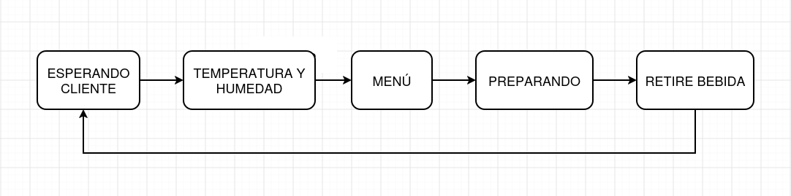

# Máquina Expendedora con Arduino
Controlador software para una máquina expendedora de café basada en **Arduino UNO**, desarrollado con los sensores y actuadores del kit de laboratorio de la asignatura. El sistema responde a eventos físicos en tiempo real e interactúa con el usuario mediante una pantalla LCD, un joystick analógico, un pulsador y dos LEDs, mientras monitoriza de forma **no bloqueante** la temperatura, la humedad y la distancia a la que se encuentra el cliente.

| Modo Arranque | Modo Servicio | Modo Admin |
|:------:|:------:|:------:|
|  |  |  |

## Índice
- [Hardware y conexiones](#hardware-y-conexiones)
- [Estructura del código](#estructura-del-código)
- [Arquitectura del software](#arquitectura-del-software)
- [Modo Arranque](#modo-arranque)
- [Modo Servicio](#modo-servicio)
- [Modo Administración](#modo-administración)
- [Demo](#demo)

## Hardware y conexiones

### Tabla de pines
| Componente | Pin | | Componente | Pin | | Componente | Pin |
|---|---|---|---|---|---|---|---|
| Botón externo | 2 | | LED2 | 6 | | DHT11 (señal) | 12 |
| LCD (pin E) | 3 | | Ultrasonidos (Echo) | 7 | | Joystick (eje VRy) | A0 |
| LCD (pines D4 a D7) | A2 a A5 | | Ultrasonidos (Trig) | 8 | | Joystick (eje VRx) | A1 |
| LCD (pin RS) | 5 | | LED1 | 11 | | Joystick (botón SW) | 4 |

El botón externo está en el pin 2 porque es uno de los pines del Arduino que admite interrupciones. El LED2 está en el pin 6 porque permite cambiar su brillo con PWM. El LCD usa solo 4 cables de datos, el pin RW va a GND y el contraste se regula con un potenciómetro. Todos los componentes se alimentan desde las líneas de 5V y GND de la protoboard, conectadas al Arduino.

### Esquema


## Estructura del código
He dividido el programa en varios ficheros, y cada uno se encarga de una parte concreta.
```
vending_machine/
├── vending_machine.ino    setup(), loop(), los tres modos y las pantallas del LCD
├── config.h               pines, tiempos, umbrales, precios y límites
├── inputs.h               declaraciones de todas las entradas
└── inputs.cpp             sensores, joystick y botón externo con su interrupción
```

El código separa las entradas de la lógica. En `inputs` está todo lo que se lee del exterior, y el fichero principal solo pregunta qué ha pasado y decide qué hacer. Además, todos los pines y tiempos están reunidos en [`config.h`](./vending_machine/config.h), así que cualquier cambio se hace en un único lugar sin tocar el resto del código.

## Arquitectura del software

### Máquina de estados
He organizado el programa como una máquina de estados con tres modos. En cada vuelta de `loop()` solo se ejecuta el código del modo en el que está la máquina.

El **modo Servicio** tiene a su vez varias fases, que se van sucediendo con cada cliente.


Así cada parte del programa sabe en qué situación está y qué tiene que hacer después.

### Sin delay()
En todo el programa no hay ningún `delay()`, porque deja el Arduino parado y no podría leer el joystick ni los sensores mientras espera. Para controlar los tiempos uso `millis()`. Guardo el momento en el que empieza una fase y en cada vuelta compruebo si ya ha pasado el tiempo que necesito. Como las fases del modo Servicio nunca ocurren a la vez, todas usan la misma variable `stateStart`.

### Hilos con ArduinoThread
Las tareas que se repiten cada cierto tiempo las he puesto en hilos de la librería ArduinoThread, que gestiona un `ThreadController`. Tengo tres hilos.

| Hilo | Cada cuánto | Qué hace |
|---|---|---|
| `distanceThread` | 200 ms | Mide la distancia con el sensor de ultrasonidos |
| `environmentThread` | 2 s | Lee la temperatura y la humedad del DHT11, que es un sensor lento |
| `refreshThread` | 500 ms | Actualiza las pantallas de temperatura, distancia y contador del modo Admin |

```cpp
distanceThread.enabled = true;
distanceThread.onRun(updateDistance);
distanceThread.setInterval(MEASURE_INTERVAL);
controller.add(&distanceThread);
```
En `loop()` solo tengo que llamar a `controller.run()` y cada hilo se ejecuta cuando le toca. El hilo de refresco está desactivado casi todo el tiempo y solo lo activo mientras se ve una de esas pantallas, porque en el resto del programa no hace falta.

### Por qué no uso TimerOne
Al principio hice el parpadeo del arranque y el contador del modo Admin con una interrupción de TimerOne cada segundo. Con esa versión la pantalla se quedaba en blanco y el parpadeo no terminaba bien, y además TimerOne usa el mismo temporizador que el PWM de los pines 9 y 10. Al final lo quité y lo hago todo con `millis()`, igual que el resto de tiempos. El parpadeo comprueba si ha pasado un segundo desde el último cambio del LED, y el contador es `millis() / 1000`, los segundos que lleva encendida la placa.

### Interrupción del botón externo
El botón externo está en el pin 2 con la resistencia pull-up interna activada. Por eso se lee HIGH cuando no está pulsado y LOW cuando se pulsa. La interrupción está en modo `CHANGE`, así que salta tanto al pulsar como al soltar.
```cpp
static void onButtonChange() {
    buttonChanged = true;
}
```
Cada vez que pulso o suelto el botón, la interrupción solo pone un aviso a `true`, para que sea lo más corta posible. La variable es `volatile` porque la cambia la interrupción. Desde el programa principal copio el aviso y lo borro con las interrupciones paradas un instante, para que no salte otra interrupción justo en medio.

Después leo el pin y aplico el antirrebote. Un cambio solo cuenta si el pin lleva 50 ms con el mismo valor. Mi primera versión calculaba el tiempo dentro de la interrupción, pero los rebotes del botón reiniciaban la cuenta y tenía que mantenerlo pulsado el doble de tiempo.

El modo Admin se activa en cuanto el botón lleva 5 segundos pulsado, sin tener que soltarlo. La cancelación, en cambio, se decide al soltar, porque mientras sigue pulsado no se sabe si se va a quedar entre 2 y 3 segundos.

Para comprobar los tiempos hice un programa de prueba que escribía por el puerto serie cuánto duraba cada pulsación, y así vi que yo contaba los segundos demasiado rápido.

### Sensores y entradas
**Joystick.** Leo los ejes con `analogRead()`, que da valores de 0 a 1023. Hay movimiento cuando el valor baja de 300 o sube de 700, y cada movimiento lo detecto una sola vez, al salir del centro, para que el menú no avance sin parar. En mi montaje el joystick está girado, por eso el eje VRx es el que controla arriba y abajo.

**Ultrasonidos.** Envío un pulso de 10 microsegundos por Trig y mido con `pulseIn()` cuánto tarda en volver el eco. Lo multiplico por 0,01715, que es la velocidad del sonido en cm por microsegundo dividida entre dos. Le pongo un tiempo máximo de 30 ms para que no se quede esperando. A veces el sensor pierde un eco aunque haya algo delante, así que solo lo trato como fuera de rango si fallan 5 medidas seguidas, es decir, un segundo entero sin eco.

**DHT11.** Lo leo con la librería de Adafruit. Si una lectura falla me quedo con la última buena, y si no hay ninguna salen dos guiones. Al principio siempre salían los guiones porque tenía la señal en el pin equivocado del módulo.

**Precios.** Los guardo en céntimos, por ejemplo 125 para 1,25 euros, para evitar errores de redondeo al cambiarlos de 0,05 en 0,05.

### Watchdog
Uso el watchdog con un tiempo de 2 segundos. Lo desactivo al empezar `setup()`, lo activo al final y lo reinicio al principio de cada vuelta de `loop()` con `wdt_reset()`. Como el programa nunca se bloquea, normalmente no llega a saltar, pero si algo se quedara colgado la placa se reiniciaría sola.

## Modo Arranque
Al encender la máquina, la pantalla muestra CARGANDO y el LED1 parpadea tres veces, una vez por segundo. El LED1 se enciende nada más arrancar y luego, cada vez que pasa un segundo según `millis()`, cambia de estado y cuento el cambio. Tres parpadeos son seis cambios entre encendido y apagado. Cuando termina, el LED1 se queda apagado y la máquina pasa sola al modo Servicio.

## Modo Servicio

### Detección del cliente
Mientras no hay nadie a menos de un metro, la pantalla muestra ESPERANDO CLIENTE. En cuanto alguien se acerca a menos de 100 cm, la máquina empieza a atenderle.

### Temperatura y humedad
Lo primero que ve el cliente es la temperatura y la humedad durante 5 segundos, cada una en una fila de la pantalla.

### Menú de productos
Después aparece el catálogo. Con el joystick hacia arriba y hacia abajo se pasa de un producto a otro, y pulsando el botón del joystick se elige el que está en pantalla.

### Preparación
Al elegir un producto, la pantalla muestra Preparando Café y empieza la preparación, que dura un tiempo aleatorio entre 4 y 8 segundos. Mientras tanto, el brillo del LED2 va subiendo poco a poco con PWM, de forma que empieza apagado y llega al máximo justo al terminar.
```cpp
analogWrite(LED2, map(elapsed, 0, prepTime, 0, 255));
```
Para que los tiempos aleatorios no se repitan cada vez que enciendo la placa, inicializo los números aleatorios con el momento exacto en el que llega el primer cliente, que nunca es el mismo.

### Retirar la bebida
Cuando termina, la pantalla muestra RETIRE BEBIDA durante 3 segundos y la máquina vuelve a esperar al siguiente cliente.

### Cancelar
En cualquier momento del modo Servicio, si se mantiene pulsado el botón externo entre 2 y 3 segundos y se suelta, se cancela todo y la máquina vuelve al principio del modo Servicio, sin reiniciar la placa.

## Modo Administración
Para entrar hay que mantener pulsado el botón externo 5 segundos, y se puede hacer en cualquier momento. Mientras estoy en este modo, los dos LEDs se quedan encendidos. Para salir se vuelve a mantener pulsado el botón 5 segundos, y la máquina regresa al modo Servicio.

En el menú me muevo con el joystick hacia arriba y hacia abajo, abro una opción pulsando el botón del joystick y vuelvo atrás moviéndolo a la izquierda.

| Opción | Qué hace |
|---|---|
| a. Temperatura | Muestra la temperatura y la humedad |
| b. Distancia | Muestra la distancia que mide el sensor de ultrasonidos |
| c. Contador | Muestra los segundos que lleva encendida la placa |
| d. Precios | Permite cambiar el precio de cada producto |

Las tres primeras pantallas se actualizan solas cada medio segundo gracias al hilo de refresco, así que los valores siempre son los más recientes.

En la fila de arriba siempre pone MENU ADMIN, y en la de abajo la opción en la que estoy. En Precios aparece el catálogo. Al pulsar sobre un producto, puedo subir o bajar su precio de 0,05 en 0,05 euros con el joystick, y lo guardo pulsando otra vez. Si vuelvo atrás con la izquierda sin pulsar, el precio no cambia. Los precios nuevos se ven enseguida en el menú de los clientes.

## Demo
- [Modo Arranque y Servicio](https://youtu.be/HCgU-bFm39k?si=RAk8QkCO6jZPm9O0)
- [Cancelación y Reinicio de Estado](https://youtu.be/F09XxKwePwQ?si=wyw5BTBqVzQ7wHdA)
- [Modo Administración (Admin)](https://youtu.be/d_26rkWZ6sM?si=UmkAzz_RtDMamuOx)
