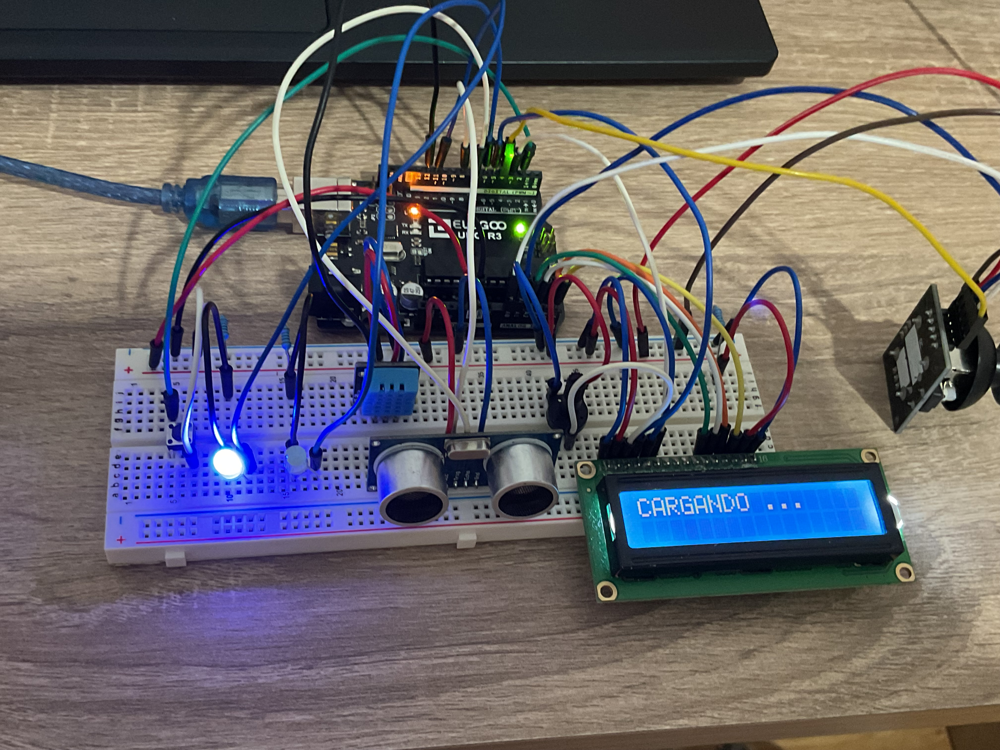
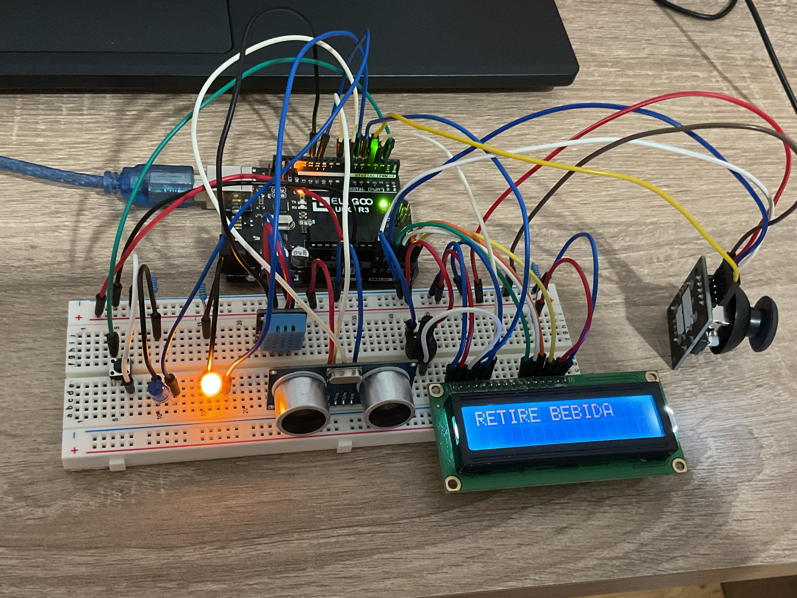

# Máquina Expendedora con Arduino
Controlador software para una máquina expendedora de café basada en **Arduino UNO**, desarrollado con los sensores y actuadores del kit de laboratorio de la asignatura. El sistema responde a eventos físicos en tiempo real e interactúa con el usuario mediante una pantalla LCD, un joystick analógico, un pulsador y dos LEDs, mientras monitoriza de forma **no bloqueante** la temperatura, la humedad y la distancia a la que se encuentra el cliente.

| Modo Arranque | Modo Servicio | Modo Admin |
|:------:|:------:|:------:|
|  |  |  |

## Índice
- [Hardware y conexiones](#hardware-y-conexiones)
- [Estructura del código](#estructura-del-código)
- [Arquitectura del software](#arquitectura-del-software)
- [Modo Arranque](#modo-arranque)
- [Modo Servicio](#modo-servicio)
- [Modo Administración](#modo-administración)
- [Demo](#demo)

## Hardware y conexiones

### Tabla de pines
| Componente | Pin | | Componente | Pin | | Componente | Pin |
|---|---|---|---|---|---|---|---|
| Botón externo | 2 | | LED2 | 6 | | DHT11 (señal) | 12 |
| LCD (pin E) | 3 | | Ultrasonidos (Echo) | 7 | | Joystick (eje VRy) | A0 |
| LCD (pines D4 a D7) | A2 a A5 | | Ultrasonidos (Trig) | 8 | | Joystick (eje VRx) | A1 |
| LCD (pin RS) | 5 | | LED1 | 11 | | Joystick (botón SW) | 4 |

El botón externo está en el pin 2 porque es uno de los pines del Arduino que admite interrupciones. El LED2 está en el pin 6 porque permite cambiar su brillo con PWM y no le afecta TimerOne, que usa los pines 9, 10 y 11. El LCD usa solo 4 cables de datos, el pin RW va a GND y el contraste se regula con un potenciómetro. Todos los componentes se alimentan desde las líneas de 5V y GND de la protoboard, conectadas al Arduino.

### Esquema


## Estructura del código
He dividido el programa en varios ficheros, y cada uno se encarga de una parte concreta.
```
vending_machine/
├── vending_machine.ino    setup(), loop(), los tres modos y las pantallas del LCD
├── config.h               pines, tiempos, umbrales, precios y límites
├── inputs.h               declaraciones de todas las entradas
└── inputs.cpp             sensores, joystick y botón externo con su interrupción
```

El código separa las entradas de la lógica. En `inputs` está todo lo que se lee del exterior, y el fichero principal solo pregunta qué ha pasado y decide qué hacer. Además, todos los pines y tiempos están reunidos en [`config.h`](./vending_machine/config.h), así que cualquier cambio se hace en un único lugar sin tocar el resto del código.

## Arquitectura del software

### Máquina de estados
He organizado el programa como una máquina de estados con tres modos. En cada vuelta de `loop()` solo se ejecuta el código del modo en el que está la máquina.

El **modo Servicio** tiene a su vez varias fases, que se van sucediendo con cada cliente.


Así cada parte del programa sabe en qué situación está y qué tiene que hacer después.

### Sin delay()
En todo el programa no hay ningún `delay()`, porque deja el Arduino parado y no podría leer el joystick ni los sensores mientras espera. Para controlar los tiempos uso `millis()`. Guardo el momento en el que empieza una fase y en cada vuelta compruebo si ya ha pasado el tiempo que necesito.
```cpp
if (millis() - stateStart >= ENV_DISPLAY_TIME) {
    selected = 0;
    showProduct(selected);
    serviceState = MENU;
}
```
Como las fases del modo Servicio nunca ocurren a la vez, todas usan la misma variable `stateStart` para guardar cuándo empezaron.

### Hilos con ArduinoThread
Las tareas que se repiten cada cierto tiempo las he puesto en hilos de la librería ArduinoThread, que gestiona un `ThreadController`. Tengo tres hilos.

| Hilo | Cada cuánto | Qué hace |
|---|---|---|
| `distanceThread` | 200 ms | Mide la distancia con el sensor de ultrasonidos |
| `environmentThread` | 2 s | Lee la temperatura y la humedad del DHT11, que es un sensor lento |
| `refreshThread` | 500 ms | Actualiza las pantallas de temperatura, distancia y contador del modo Admin |

```cpp
distanceThread.enabled = true;
distanceThread.onRun(updateDistance);
distanceThread.setInterval(MEASURE_INTERVAL);
controller.add(&distanceThread);
```
En `loop()` solo tengo que llamar a `controller.run()` y cada hilo se ejecuta cuando le toca. El hilo de refresco está desactivado casi todo el tiempo y solo lo activo mientras se ve una de esas pantallas, porque en el resto del programa no hace falta.

### Interrupción por tiempo con TimerOne
Con la librería TimerOne he configurado el Timer1 para que lance una interrupción cada segundo.
```cpp
Timer1.initialize(TIMER_PERIOD);
Timer1.attachInterrupt(onTimer);
```
Esta interrupción hace dos cosas. Durante el arranque cambia el estado del LED1 para hacer el parpadeo, y siempre suma un segundo al contador de tiempo encendido que se ve en el modo Admin. Como TimerOne usa el mismo temporizador que el PWM de los pines 9, 10 y 11, puse el LED2 en el pin 6, que depende del Timer0.

### Interrupción del botón externo
El botón externo está en el pin 2 con la resistencia pull-up interna activada. Por eso se lee HIGH cuando no está pulsado y LOW cuando se pulsa. La interrupción está en modo `CHANGE`, así que salta tanto al pulsar como al soltar.
```cpp
void onButtonChange() {
    if (digitalRead(BUTTON) == LOW) {
        pressed = true;
        pressStart = millis();
    } else {
        if (pressed) {
            unsigned long d = millis() - pressStart;
            if (d > BUTTON_DEBOUNCE) {
                pressDuration = d;
            }
        }
        pressed = false;
    }
}
```
Al pulsar guardo el momento, y al soltar calculo cuánto tiempo ha estado pulsado. He intentado que la rutina sea lo más corta posible, sin escribir en el LCD ni usar el puerto serie. Las variables que comparte con el resto del programa son `volatile`, y las pulsaciones de menos de 50 ms las descarto porque son rebotes del botón.

Cuando leo esas variables desde el programa principal, desactivo las interrupciones un instante. Son variables de 4 bytes y el Arduino las lee en varios pasos, así que si la interrupción saltara justo en medio podría leer un valor a medias.

El modo Admin se activa en cuanto el botón lleva 5 segundos pulsado, sin tener que soltarlo. La cancelación, en cambio, se decide al soltar, porque mientras sigue pulsado no se sabe si se va a quedar entre 2 y 3 segundos.

### Joystick
Los ejes se leen con `analogRead()`, que da valores entre 0 y 1023 con el centro en unos 512. Considero que hay movimiento cuando el valor baja de 300 o sube de 700, para tener margen cuando el joystick está quieto.

Cada movimiento lo detecto una sola vez, justo cuando el joystick sale del centro. Si no lo hiciera así, al mantenerlo hacia abajo el menú avanzaría miles de veces por segundo. El botón del joystick tiene su propio antirrebote de 50 ms. En mi montaje el joystick está girado, por eso en el código el eje VRx es el que controla arriba y abajo.

### Sensor de ultrasonidos
Para medir la distancia envío un pulso de 10 microsegundos por el pin Trig y mido con `pulseIn()` cuánto tiempo está el pin Echo en HIGH. Ese tiempo es lo que tarda el sonido en ir y volver, así que lo multiplico por 0,01715 cm por microsegundo, que es la velocidad del sonido dividida entre dos.
```cpp
long duration = pulseIn(ECHO, HIGH, ECHO_TIMEOUT);
distance = duration * CM_PER_US;
```
A `pulseIn()` le pongo un tiempo máximo de 30 ms. Sin ese límite podría quedarse esperando hasta un segundo si no llega el eco, y así como mucho espera 30 ms cada 200 ms. Si no llega eco, lo trato como fuera de rango y nunca como un cliente cerca.

### Sensor DHT11
La temperatura y la humedad las leo con la librería DHT de Adafruit. Si una lectura falla, la librería devuelve un valor que no es un número. En ese caso me quedo con la última lectura buena, y si todavía no hay ninguna, en la pantalla salen dos guiones en vez de un valor falso.

### Precios en céntimos
Guardo los precios como números enteros en céntimos, por ejemplo 125 para 1,25 euros. Así evito los errores de redondeo de los decimales al subir o bajar el precio de 0,05 en 0,05.
```cpp
int prices[NUM_PRODUCTS] = {100, 110, 125, 150, 200};
```

### Watchdog
Uso el watchdog con un tiempo de 2 segundos. Lo desactivo al empezar `setup()`, lo activo al final y lo reinicio al principio de cada vuelta de `loop()`. Como el programa nunca se bloquea, normalmente no llega a saltar, pero si algo se quedara colgado la placa se reiniciaría sola.
```cpp
void loop() {
    wdt_reset();
    controller.run();
    ...
}
```

### Pantalla LCD
La pantalla tiene 16 columnas, así que los mensajes largos como ESPERANDO CLIENTE o Preparando Café los reparto en las dos filas. Tampoco tiene tildes ni el símbolo del euro, por eso escribo Cafe y EUR. Para el símbolo de grado uso el carácter 223, que es el que le corresponde en este tipo de pantallas.

## Modo Arranque
Al encender la máquina, la pantalla muestra CARGANDO y el LED1 parpadea tres veces, una vez por segundo. El parpadeo lo hace la interrupción de TimerOne. Cada segundo cambia el estado del LED y cuenta el cambio, y tres parpadeos son seis cambios entre encendido y apagado. Cuando termina, el LED1 se queda apagado y la máquina pasa sola al modo Servicio.

## Modo Servicio

### Detección del cliente
Mientras no hay nadie a menos de un metro, la pantalla muestra ESPERANDO CLIENTE. En cuanto alguien se acerca a menos de 100 cm, la máquina empieza a atenderle.

### Temperatura y humedad
Lo primero que ve el cliente es la temperatura y la humedad durante 5 segundos, cada una en una fila de la pantalla.

### Menú de productos
Después aparece el catálogo. Con el joystick hacia arriba y hacia abajo se pasa de un producto a otro, y pulsando el botón del joystick se elige el que está en pantalla.

| Producto | Precio inicial |
|---|---|
| Café Solo | 1,00 EUR |
| Café Cortado | 1,10 EUR |
| Café Doble | 1,25 EUR |
| Café Premium | 1,50 EUR |
| Chocolate | 2,00 EUR |

### Preparación
Al elegir un producto, la pantalla muestra Preparando Café y empieza la preparación, que dura un tiempo aleatorio entre 4 y 8 segundos. Mientras tanto, el brillo del LED2 va subiendo poco a poco con PWM, de forma que empieza apagado y llega al máximo justo al terminar.
```cpp
analogWrite(LED2, map(elapsed, 0, prepTime, 0, 255));
```
Para que los tiempos aleatorios no se repitan cada vez que enciendo la placa, inicializo los números aleatorios con el momento exacto en el que llega el primer cliente, que nunca es el mismo.

### Retirar la bebida
Cuando termina, la pantalla muestra RETIRE BEBIDA durante 3 segundos y la máquina vuelve a esperar al siguiente cliente.

### Cancelar
Si mientras se atiende al cliente se mantiene pulsado el botón externo entre 2 y 3 segundos, se cancela todo y la máquina vuelve al principio del modo Servicio.

## Modo Administración
Para entrar hay que mantener pulsado el botón externo 5 segundos, y se puede hacer en cualquier momento. Mientras estoy en este modo, los dos LEDs se quedan encendidos. Para salir se vuelve a mantener pulsado el botón 5 segundos, y la máquina regresa al modo Servicio.

En el menú me muevo con el joystick hacia arriba y hacia abajo, abro una opción pulsando el botón del joystick y vuelvo atrás moviéndolo a la izquierda.

| Opción | Qué hace |
|---|---|
| Ver temperatura | Muestra la temperatura y la humedad |
| Ver distancia | Muestra la distancia que mide el sensor de ultrasonidos |
| Ver contador | Muestra los segundos que lleva encendida la placa, contados con TimerOne |
| Modificar precios | Permite cambiar el precio de cada producto |

Las tres primeras pantallas se actualizan solas cada medio segundo gracias al hilo de refresco, así que los valores siempre son los más recientes.

En Modificar precios aparece el catálogo. Al pulsar sobre un producto, puedo subir o bajar su precio de 0,05 en 0,05 euros con el joystick, y lo guardo pulsando otra vez. Si vuelvo atrás con la izquierda sin pulsar, el precio no cambia. Los precios nuevos se ven enseguida en el menú de los clientes.

## Demo