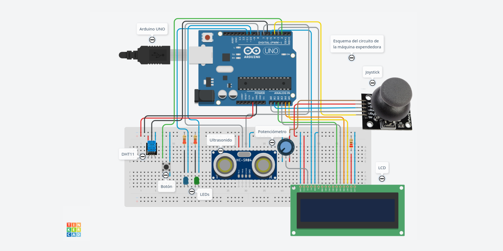

# Máquina Expendedora con Arduino
Controlador software para una máquina expendedora de café basada en **Arduino UNO**, desarrollado con los sensores y actuadores del kit de laboratorio de la asignatura. El sistema responde a eventos físicos en tiempo real e interactúa con el usuario mediante una pantalla LCD, un joystick analógico, un pulsador y dos LEDs, mientras monitoriza de forma **no bloqueante** la temperatura, la humedad y la distancia a la que se encuentra el cliente.

## Índice
- [Hardware y conexiones](#hardware-y-conexiones)
- [Estructura del código](#estructura-del-código)
- [Arquitectura del software](#arquitectura-del-software)
- [Modo Arranque](#modo-arranque)
- [Modo Servicio](#modo-servicio)
- [Modo Administración](#modo-administración)
- [Problemas y soluciones](#problemas-y-soluciones)

## Hardware y conexiones

### Tabla de pines
| Componente | Pin del Arduino |
|---|---|
| Pulsador externo | 2 |
| LCD, pin E | 3 |
| Joystick, botón SW | 4 |
| LCD, pin RS | 5 |
| DHT11, señal | 6 |
| Ultrasonidos, Echo | 7 |
| Ultrasonidos, Trig | 8 |
| LED2 | 10 |
| LED1 | 11 |
| Joystick, eje VRy | A0 |
| Joystick, eje VRx | A1 |
| LCD, pines D4 a D7 | A2 a A5 |

### Esquema


## Estructura del código
El programa está dividido en varios ficheros, cada uno con una responsabilidad concreta.
 
```
vending_machine/
├── vending_machine.ino     setup(), loop(), máquina de estados y pantallas del LCD
├── config.h                pines y constantes (tiempos, umbrales, precios y límites)
├── button.h                declaraciones del botón
├── button.cpp              interrupción, antirrebote y duración de cada pulsación
├── joystick.h              declaraciones del joystick
├── joystick.cpp            lectura del joystick, cada movimiento o pulsación una sola vez
├── sensors.h               declaraciones de los sensores
└── sensors.cpp             lectura del sensor de ultrasonidos y del DHT11
```

